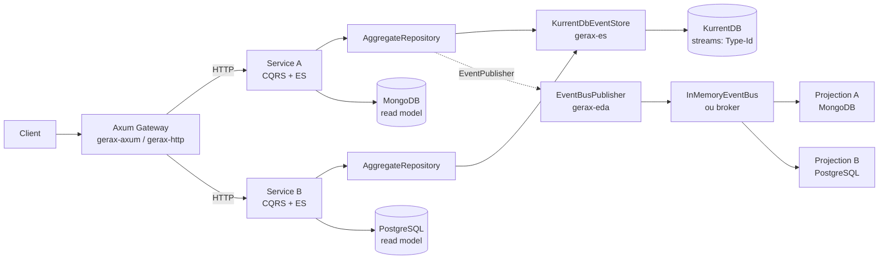

# Como usar `gerax-es` + `gerax-eda` integrados

## Ideia central

As duas crates têm papéis complementares:

```text
gerax-es   → registra o que aconteceu   (Aggregate + EventStore)
gerax-eda  → distribui o que aconteceu  (EventBus + Handlers)
```

A integração já vem pronta na própria `gerax-eda`: o tipo **`EventBusPublisher`** implementa a porta `gerax_es::EventPublisher`, lê `StoredEvent`s já persistidos, desserializa o payload tipado e publica um `EventEnvelope` no bus.

A regra de ouro:

```text
Aggregate.raise()
      ↓
Repository.save() / EventStore.append()   ← persistência confirmada
      ↓
EventBusPublisher.publish()               ← só depois de persistir
      ↓
EventBus → N handlers
```

O domínio **não** conhece o bus. O `EventStore` **não** conhece o bus. A orquestração fica na camada de aplicação (service, command handler, etc.).

---

## 1. Dependências

```toml
[dependencies]
gerax-es  = "..."   # ou { path = "../../crates/gerax-es" }
gerax-eda = "..."   # ou { path = "../../crates/gerax-eda" }

serde      = { version = "1", features = ["derive"] }
serde_json = "1"
async-trait = "0.1"
tokio      = { version = "1", features = ["macros", "rt-multi-thread"] }
thiserror  = "2"
```

`gerax-eda` já depende de `gerax-es`, mas você declara as duas porque vai usar tipos das duas diretamente.

---

## 2. O evento compartilhado

O ponto mais importante da integração: **o mesmo tipo de evento** é usado pelo `gerax-es` (persistência) e pelo `gerax-eda` (distribuição).

Para o `JsonEventSerializer`, o enum precisa ter a tag interna `event_type`, e o `Event::event_type()` precisa devolver exatamente o mesmo nome:

```rust
use gerax_eda::Event;
use serde::{Deserialize, Serialize};

#[derive(Debug, Clone, PartialEq, Serialize, Deserialize)]
#[serde(tag = "event_type")]
pub enum StudentEvent {
    StudentCreated { name: String },
    StudentRenamed { name: String },
}

impl Event for StudentEvent {
    fn event_type(&self) -> &'static str {
        match self {
            Self::StudentCreated { .. } => "StudentCreated",
            Self::StudentRenamed { .. }  => "StudentRenamed",
        }
    }
}
```

Se esses dois nomes divergirem, o bus rejeita o envelope com `EventBusError::InvalidEvent`.

---

## 3. O Aggregate com `gerax-es`

O Aggregate só aplica eventos e acumula eventos pendentes — nada de IO nem bus:

```rust
use gerax_es::{Aggregate, AggregateApplier, Version};

#[derive(Debug, Aggregate)]
pub struct Student {
    id: String,
    name: String,
    version: Version,
    pending: Vec<StudentEvent>,
}

impl AggregateApplier for Student {
    type Event = StudentEvent;
    type Error = std::convert::Infallible;

    fn apply(&mut self, event: &Self::Event) -> Result<(), Self::Error> {
        match event {
            StudentEvent::StudentCreated { name }
            | StudentEvent::StudentRenamed { name } => {
                self.name = name.clone();
            }
        }
        self.version = self.version.next();
        Ok(())
    }
}
```

O `#[derive(Aggregate)]` gera `empty`, `id`, `version`, `raise`, `take_events` e `aggregate_type` (por padrão, o nome da struct: `"Student"`).

---

## 4. Os consumidores com `gerax-eda`

Cada handler recebe um `EventEnvelope<StudentEvent>` com id, payload e metadata. Podem existir **N handlers para o mesmo evento**:

```rust
use gerax_eda::{EventEnvelope, EventHandler, EventHandlerError};

struct LogDeEventos;

#[async_trait::async_trait]
impl EventHandler<StudentEvent> for LogDeEventos {
    async fn handle(
        &self,
        envelope: EventEnvelope<StudentEvent>,
    ) -> Result<(), EventHandlerError> {
        println!("[{}] {:?}", envelope.event_type(), envelope.event);
        Ok(())
    }
}

struct AtualizarReadModel;

#[async_trait::async_trait]
impl EventHandler<StudentEvent> for AtualizarReadModel {
    async fn handle(
        &self,
        envelope: EventEnvelope<StudentEvent>,
    ) -> Result<(), EventHandlerError> {
        // projeção / notificação / integração...
        let _ = envelope.event;
        Ok(())
    }
}
```

---

## 5. Montando o bus e a ponte

```rust
use std::sync::Arc;

use gerax_eda::{EventBus, EventBusPublisher, InMemoryEventBus};
use gerax_es::{
    AggregateRepository, EventPublisher, EventSourcedRepository, EventStore,
    InMemoryEventStore, JsonEventSerializer,
};

let store = Arc::new(InMemoryEventStore::new());

// Lado ES: persistência/reidratação
let repository = EventSourcedRepository::new(
    store.clone(),
    JsonEventSerializer::<StudentEvent>::new(),
);

// Lado EDA: bus + handlers
let bus = InMemoryEventBus::new();
bus.register::<StudentEvent, _>(LogDeEventos);
bus.register::<StudentEvent, _>(AtualizarReadModel);

// Ponte ES → EDA
let publisher = EventBusPublisher::new(
    bus,
    JsonEventSerializer::<StudentEvent>::new(),
);
```

O `EventBusPublisher`:

- usa o mesmo serializer do repositório para desserializar `StoredEvent.payload`;
- monta o envelope com `EventEnvelope::from_stored`, preservando `event_id`, `occurred_at`, `correlation_id`, `causation_id` e headers;
- encaminha qualquer falha de desserialização ou de handler como `PublishError`.

> O trait `gerax_es::EventPublisher` precisa estar no `use` para o método `.publish(...)` funcionar.

---

## 6. Fluxo completo

```rust
#[tokio::main]
async fn main() -> Result<(), Box<dyn std::error::Error>> {
    let store = Arc::new(InMemoryEventStore::new());

    let repository = EventSourcedRepository::new(
        store.clone(),
        JsonEventSerializer::<StudentEvent>::new(),
    );

    let bus = InMemoryEventBus::new();
    bus.register::<StudentEvent, _>(LogDeEventos);
    bus.register::<StudentEvent, _>(AtualizarReadModel);

    let publisher = EventBusPublisher::new(
        bus,
        JsonEventSerializer::<StudentEvent>::new(),
    );

    // --- Criar ---
    let mut student = Student::empty("student-1".into());
    let antes = student.version(); // 0

    student.raise(StudentEvent::StudentCreated { name: "Ana".into() })?;

    repository.save(&mut student).await?;              // 1. persiste
    publicar_novos(&store, &publisher, &student, antes).await?; // 2. publica

    // --- Renomear ---
    let mut student = repository.load(&"student-1".to_string()).await?;
    let antes = student.version(); // 1

    student.raise(StudentEvent::StudentRenamed { name: "Bia".into() })?;

    repository.save(&mut student).await?;
    publicar_novos(&store, &publisher, &student, antes).await?;

    Ok(())
}
```

Helper que publica **apenas os eventos novos** da stream:

```rust
async fn publicar_novos<S, P>(
    store: &S,
    publisher: &P,
    student: &Student,
    antes: gerax_es::Version,
) -> Result<(), Box<dyn std::error::Error>>
where
    S: EventStore,
    P: EventPublisher,
{
    let novos = store
        .load(Student::aggregate_type(), student.id())
        .await?
        .into_iter()
        .filter(|evento| evento.version > antes)
        .collect::<Vec<_>>();

    publisher.publish(&novos).await?;
    Ok(())
}
```

### Atenção ao `antes`

Capture a versão **antes do `raise`**, não depois. O `raise` já chama `apply` e incrementa a versão do Aggregate. Se você capturar depois, o filtro não encontra nenhum evento novo.

```rust
let antes = student.version(); // ✅ correto
student.raise(evento)?;
```

---

## 7. Publicar a stream inteira ou só os novos?

O exemplo oficial (`crates/gerax-eda/examples/aluno_matriculado.rs`) publica a stream completa:

```rust
let persisted = store.load(Student::aggregate_type(), student.id()).await?;
publisher.publish(&persisted).await?;
```

Isso é simples e funciona, mas tem consequência: **cada save republica o histórico anterior**.

A semântica documentada é **at-least-once**:

- o framework não deduplica por `event_id`;
- consumidores devem ser idempotentes;
- publicar duas vezes entrega duas vezes.

Se você publica só a fatia nova (como no helper acima), evita reentregas desnecessárias. Se publica a stream inteira, precisa de projeções idempotentes. As duas abordagens são válidas; a segunda é a que o teste `crates/gerax-eda/tests/cqrs_es_eda.rs` usa para demonstrar o comportamento.

---

## 8. Comportamento do bus em memória

O `InMemoryEventBus` é **síncrono-sequencial**, embora a API seja `async`:

- handlers executam na ordem de registro;
- a falha de um não impede os outros;
- se algum falhar após o retry, `publish` devolve `EventBusError::HandlerFailed` com todas as falhas;
- evento sem nenhum handler registrado → `EventBusError::HandlerNotFound` (não é no-op silencioso);
- retry só ocorre para `EventHandlerError::Retryable`;
- o padrão é `max_attempts = 1` (sem retry).

Exemplo de configuração:

```rust
use gerax_eda::RetryPolicy;

let bus = InMemoryEventBus::new()
    .with_retry_policy(RetryPolicy::new(3));
```

---

## 9. Erros comuns

| Sintoma | Causa |
|---|---|
| `InvalidEvent: metadata.event_type ... does not match` | `Event::event_type()` não bate com a tag `event_type` serializada. |
| `HandlerNotFound` dentro de `PublishError::Publish` | Nenhum handler registrado para aquele evento. |
| Eventos antigos chegando de novo | Você está publicando `store.load(...)` completo; esperado na semântica at-least-once. |
| Evento persistido mas não distribuído | `publish` falhou depois do `save`; os eventos continuam no store. Reprocesse/publica depois (base para Outbox). |
| `publish` não compila | Faltou importar `gerax_es::EventPublisher`. |

Fluxo de falha:

```text
save OK + publish falhou
    → eventos estão persistidos (fonte da verdade)
    → consumidores não receberam
    → republique a stream / use Outbox no futuro
```

Nunca faça o contrário (publicar antes de persistir): um consumidor poderia reagir a um evento que não existe no store.

---

## 10. Em produção

A integração não muda quando você troca as implementações:

**Event Store (gerax-es):**

```toml
gerax-es = { ..., features = ["postgres"] }  # ou "mongodb", "kurrentdb"
```

```rust
use gerax_es::adapters::postgres::PostgresEventStore;

let store = PostgresEventStore::connect("postgres://...").await?;
store.ensure_schema().await?;
```

O `EventSourcedRepository` e o `EventBusPublisher` continuam iguais. Só o `Arc<InMemoryEventStore>` vira o adapter concreto.

**Event Bus (gerax-eda):**

As crates `gerax-rabbitmq` e `gerax-nats` implementam a mesma porta `EventBus`:

```text
EventBusPublisher<RabbitMqEventBus<...>, JsonEventSerializer<E>>
EventBusPublisher<NatsEventBus,             JsonEventSerializer<E>>
```

Ou seja, a ponte `EventStore → EventBus` é a mesma; só muda o bus injetado.

---

## 11. Como são realizadas as projections

### Resposta curta

Não é obrigatório ter outro banco como MongoDB.

No Gerax, uma **projection** é simplesmente um `EventHandler<E>` que grava em um **read model**. O `gerax-eda` não tem um tipo `Projection` separado: a projection é um consumidor do bus como qualquer outro.

```text
Write side (gerax-es)                    Read side (gerax-eda)
─────────────────────                    ─────────────────────
Aggregate                                EventBus
   │ raise                                  │
   ▼                                        ├── Projection handler ──► read model
EventStore (eventos)                        │                              │
   │                                        └── outro handler              ▼
   └── EventBusPublisher ──────────────────►                          QueryHandler
```

O read model pode ser:

| Onde | Quando faz sentido |
|---|---|
| `Arc<Mutex<HashMap<...>>>` | testes, exemplos, monolito simples |
| Outra tabela no **mesmo PostgreSQL** | você já usa Postgres e quer SQL/joins/relatórios |
| Outra coleção no **mesmo MongoDB** | documentos agregados, schema flexível |
| Redis / outro Mongo / OpenSearch | leitura escalando separado, full-text, agregações pesadas |
| Outro serviço/banco | isolamento entre contextos, múltiplos times |

Ou seja: **“outro store” não significa necessariamente “outro banco”**. Na maioria dos casos, é só outra tabela/coleção no banco que você já tem.

> Atenção: o `MongoDbEventStore` do `gerax-es` é um adapter do **Event Store** (write side), não um mecanismo de projection. Você pode usar MongoDB como read model, mas isso é uma decisão independente de onde os eventos estão persistidos.

### O que uma projection precisa

1. **Um evento com as chaves necessárias** — normalmente o id do aggregate.
2. **Um handler idempotente** — a entrega é *at-least-once*.
3. **Um lugar para gravar** — memória, tabela, coleção etc.
4. **Registro no bus** — `bus.register::<E, _>(handler)`.

#### Ponto importante: o envelope não carrega `aggregate_id` nem `version`

O `EventEnvelope` atual contém:

```text
id, event, metadata { event_type, occurred_at, correlation_id, causation_id, headers }
```

`EventEnvelope::from_stored` preserva `event_id` e `occurred_at`, mas **não copia** `aggregate_id` nem `version` do `StoredEvent`.

Por isso, o evento de domínio precisa carregar o que a projection usa. O exemplo oficial já faz isso:

```rust
#[derive(Debug, Clone, Serialize, Deserialize)]
#[serde(tag = "event_type")]
enum StudentEvent {
    StudentCreated { id: String, name: String },
    StudentRenamed { id: String, name: String },
}
```

Se você quiser que a projection receba `aggregate_id`/`version` sem poluir o evento, pode usar um publisher próprio que enriquece os headers:

```rust
let envelope = EventEnvelope::from_stored(event, stored)
    .with_header("aggregate_id", stored.aggregate_id.clone())
    .with_header("version", stored.version.to_string());
```

Hoje isso exigiria substituir o `EventBusPublisher` por uma implementação própria da porta `EventPublisher` — ou evoluir a crate para incluir esses campos no envelope.

### Exemplo 1: projection em memória

É o que os exemplos e testes usam:

```rust
type ReadModel = Arc<Mutex<HashMap<String, String>>>;

#[derive(Clone)]
struct ProjetarEstudante {
    alunos: ReadModel,
}

#[async_trait::async_trait]
impl EventHandler<StudentEvent> for ProjetarEstudante {
    async fn handle(
        &self,
        envelope: EventEnvelope<StudentEvent>,
    ) -> Result<(), EventHandlerError> {
        match envelope.event {
            StudentEvent::StudentCreated { id, name }
            | StudentEvent::StudentRenamed { id, name } => {
                self.alunos.lock().unwrap().insert(id, name);
            }
        }
        Ok(())
    }
}
```

Registro:

```rust
let alunos: ReadModel = Arc::new(Mutex::new(HashMap::new()));

bus.register::<StudentEvent, _>(ProjetarEstudante {
    alunos: alunos.clone(),
});
```

O `QueryHandler` lê esse read model. É o fluxo do teste `crates/gerax-eda/tests/cqrs_es_eda.rs`.

### Exemplo 2: projection no mesmo PostgreSQL

Suponha que o Event Store já está no Postgres (`PostgresEventStore`). Basta criar outra tabela para o read model:

```sql
CREATE TABLE student_view (
    student_id TEXT PRIMARY KEY,
    name       TEXT NOT NULL,
    updated_at TIMESTAMPTZ NOT NULL DEFAULT now()
);

-- deduplicação de entregas (at-least-once)
CREATE TABLE processed_event (
    event_id UUID PRIMARY KEY,
    processed_at TIMESTAMPTZ NOT NULL DEFAULT now()
);
```

Handler com deduplicação e upsert:

```rust
use gerax_eda::{EventEnvelope, EventHandler, EventHandlerError};
use sqlx::PgPool;

struct StudentProjection {
    pool: PgPool,
}

#[async_trait::async_trait]
impl EventHandler<StudentEvent> for StudentProjection {
    async fn handle(
        &self,
        envelope: EventEnvelope<StudentEvent>,
    ) -> Result<(), EventHandlerError> {
        let mut tx = self
            .pool
            .begin()
            .await
            .map_err(|e| EventHandlerError::Retryable(e.to_string()))?;

        // 1. dedupe: se o event_id já foi processado, não aplica de novo
        let inserted = sqlx::query(
            "INSERT INTO processed_event (event_id)
             VALUES ($1)
             ON CONFLICT (event_id) DO NOTHING",
        )
        .bind(envelope.id.as_uuid())
        .execute(&mut *tx)
        .await
        .map_err(|e| EventHandlerError::Retryable(e.to_string()))?;

        if inserted.rows_affected() == 1 {
            match &envelope.event {
                StudentEvent::StudentCreated { id, name }
                | StudentEvent::StudentRenamed { id, name } => {
                    // 2. upsert do read model
                    sqlx::query(
                        "INSERT INTO student_view (student_id, name, updated_at)
                         VALUES ($1, $2, now())
                         ON CONFLICT (student_id) DO UPDATE
                         SET name = EXCLUDED.name,
                             updated_at = EXCLUDED.updated_at",
                    )
                    .bind(id)
                    .bind(name)
                    .execute(&mut *tx)
                    .await
                    .map_err(|e| EventHandlerError::Retryable(e.to_string()))?;
                }
            }
        }

        tx.commit()
            .await
            .map_err(|e| EventHandlerError::Retryable(e.to_string()))?;

        Ok(())
    }
}
```

Registro:

```rust
let pool = /* PgPool do seu app */;
bus.register::<StudentEvent, _>(StudentProjection { pool });
```

Nesse desenho, os eventos e o read model estão no **mesmo banco**, mas em tabelas diferentes:

```text
PostgreSQL
├── event_store     ← write model / fonte da verdade
├── processed_event ← controle de idempotência
└── student_view    ← read model / consultas
```

### Exemplo 3: MongoDB como read model

Se você já usa Mongo, pode manter eventos e projections no mesmo banco, em coleções diferentes:

```text
MongoDB
├── events            ← EventStore
├── stream_versions   ← controle de versão do EventStore
└── student_view      ← read model
```

Com o driver do Mongo, a escrita idempotente fica natural: `_id` determinístico + `replace_one(..., upsert: true)`.

```rust
use mongodb::{Collection, bson::doc};

struct StudentProjection {
    collection: Collection<StudentView>,
}

#[async_trait::async_trait]
impl EventHandler<StudentEvent> for StudentProjection {
    async fn handle(
        &self,
        envelope: EventEnvelope<StudentEvent>,
    ) -> Result<(), EventHandlerError> {
        let (id, name) = match &envelope.event {
            StudentEvent::StudentCreated { id, name }
            | StudentEvent::StudentRenamed { id, name } => (id.clone(), name.clone()),
        };

        let view = StudentView { student_id: id.clone(), name };

        self.collection
            .replace_one(doc! { "_id": &id }, &view)
            .upsert(true)
            .await
            .map_err(|e| EventHandlerError::Retryable(e.to_string()))?;

        Ok(())
    }
}
```

Isso **não exige** trocar o Event Store para Mongo. Você pode ter eventos no Postgres e read model no Mongo — mas isso adiciona dois bancos para operar.

### Consistência, idempotência e replay

**Consistência**

- Com `InMemoryEventBus`, a entrega é **síncrona-sequencial**: quando `publish` retorna, a projection já rodou.
- Com broker real (`gerax-rabbitmq`, `gerax-nats`), a projection é **eventualmente consistente**.
- O `save` e o `publish` **não são transacionais entre si**. Se o processo cair entre os dois, o evento fica no Event Store mas não chega à projection. O padrão Outbox é a evolução natural (já citado na documentação do `gerax-es`), mas não está implementado.

**Idempotência**

A entrega é *at-least-once*. Estratégias comuns:

1. **Upsert por chave de negócio** (`student_id`) — a projection converge.
2. **Tabela/coleção de eventos processados** (`event_id` único) — evita reprocessar.
3. **Versão monotônica** (`last_version`) — aplica só se `version > last_version`; para isso a versão precisa chegar ao handler (hoje não vem no envelope; ver observação acima).

**Replay / rebuild**

O trait `EventStore` atual expõe apenas:

```rust
async fn load(&self, aggregate_type: &str, aggregate_id: &str) -> Result<Vec<StoredEvent>, ...>;
async fn append(...);
```

Não existe `load_all` nem stream global. Para reconstruir uma projection hoje você precisa:

- consultar diretamente a tabela/coleção de eventos (`event_store` no Postgres, `events` no Mongo); ou
- adicionar um método de leitura global ao adapter/porta;
- ou publicar novamente as streams que você conhece.

Isso é uma limitação atual da porta, não da ideia de projection.

### Quando usar outro banco?

Use um banco separado para o read model quando houver uma razão concreta:

- consultas que o banco atual não atende bem (full-text, busca facetada, agregações pesadas);
- necessidade de escalar leitura independentemente da escrita;
- isolamento entre serviços/contextos;
- read model mantido por outro time/processo.

Caso contrário, comece simples:

```text
Mesmo PostgreSQL:
  event_store + student_view

ou mesmo MongoDB:
  events + student_view
```

Isso reduz custo operacional, evita dual-write entre bancos e mantém o rebuild mais simples.

### Resumo

- Projection no Gerax = `EventHandler<E>` gravando em um read model.
- Não existe uma abstração `Projection` na crate; o bus é o mecanismo.
- **Não é obrigatório** ter MongoDB nem outro banco.
- O mais comum é outra tabela/coleção no banco que você já usa.
- A projection precisa ser **idempotente** (`upsert`, dedupe por `event_id` ou versão).
- Inclua no evento as chaves que a projection precisa (`id`, etc.), porque o envelope atual não carrega `aggregate_id`/`version`.
- Com broker, a consistência é eventual; com bus em memória, é síncrona.
- Rebuild global ainda exige leitura direta do Event Store ou evolução da porta `EventStore`.

---

## 13. Aplicação multi-serviço com gateway Axum

### Visão geral



### Papéis dos componentes

- **Gateway (Axum)**: roteamento, autenticação, agregação. Usa `gerax-axum`/`gerax-http`.
- **Services**: binários Rust com `CommandBus`/`QueryBus` (`gerax-cqrs`), agregados (`gerax-es`) e handlers.
- **Write side**: comandos → `CommandHandler` → `Aggregate::raise` → `EventSourcedRepository::save` → `KurrentDbEventStore::append` (optimistic concurrency por stream `Type-Id`).
- **Read side**: projections consomem `StoredEvent` via `EventBusPublisher` (`gerax-eda`) e atualizam read models (Mongo/Postgres) consultados por queries.
- **EDA**: `InMemoryEventBus` (ou adapter futuro) distribui eventos para N handlers (diário, notificações, projections).

### Fluxo de comando

```text
HTTP POST /alunos
  → Axum handler
    → CommandBus.dispatch(CreateAluno)
      → CommandHandler (validação + agregado)
        → repo.save(&mut aluno)              // append no KurrentDB
          → EventBusPublisher.publish        // StoredEvent
            → InMemoryEventBus → handlers    // projections, notificações
  → 201 Created
```

### Fluxo de query

```text
HTTP GET /alunos/{id}
  → Axum handler
    → QueryBus.execute(GetAluno)
      → QueryHandler lê read model (Mongo/Postgres)
  → 200 OK
```

### Dependências (Cargo.toml por serviço)

```toml
[dependencies]
gerax-cqrs = { path = "...", features = ["event-sourcing"] }
gerax-es    = { path = "...", features = ["kurrentdb"] }
gerax-eda   = { path = "..." }
gerax-axum  = { path = "..." }   # ou gerax-http
gerax-mongodb  = { path = "..." } # read model
gerax-postgres = { path = "..." } # read model
```

### Wiring típico (main.rs de um serviço)

```rust
let store = KurrentDbEventStore::connect(KDB_URL).await?;
let repo = EventSourcedRepository::new(store, JsonEventSerializer::new());
let bus = InMemoryEventBus::new();
let publisher = EventBusPublisher::new(bus.clone(), JsonEventSerializer::new());

bus.register::<AlunoCreated, _>(AtualizarReadModelMongo::new(mongo.clone()));

let mut registry = HandlerRegistry::new();
register_commands!(registry, CreateAlunoHandler::new(repo.clone(), publisher));
register_queries!(registry, GetAlunoHandler::new(mongo.clone()));
let registry = Arc::new(registry);

let app = Router::new()
    .route("/alunos", post(create).get(list))
    .route("/alunos/:id", get(get))
    .with_state(AppState {
        command_bus: CommandBus::new(registry.clone()),
        query_bus: QueryBus::new(registry),
    });
axum::serve(listener, app).await?;
```

### Regras de isolamento

- Cada serviço tem seu próprio DB (write = KurrentDB streams por aggregate; read = Mongo/Postgres próprios).
- Não compartilhe read models entre serviços; use EDA para sincronizar.
- Concorrência otimista no `append` evita lost updates.
- Consumidores idempotentes (at-least-once delivery).

---

## 12. Referências no repositório

- `crates/gerax-es/examples/student.rs` — Event Sourcing puro.
- `crates/gerax-eda/examples/aluno_matriculado.rs` — CQRS + ES + EDA com a ponte.
- `crates/gerax-eda/tests/cqrs_es_eda.rs` — fluxo completo `Command → Aggregate → EventStore → EventBusPublisher → Bus → Projeção → Query`, incluindo redelivery e idempotência.
- `crates/gerax-es/README.md` e `crates/gerax-eda/README.md`.

Para executar:

```sh
cargo run -p gerax-es  --example student
cargo run -p gerax-eda --example aluno_matriculado
cargo test -p gerax-eda --test cqrs_es_eda
```

Resumindo: **`save` primeiro, `EventBusPublisher` depois**. O Aggregate e o Event Store ficam isolados; o bus recebe envelopes tipados com a identidade e a metadata originais. O resto é composição de handlers.
