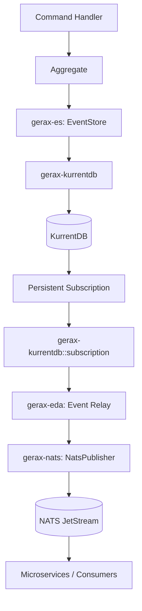
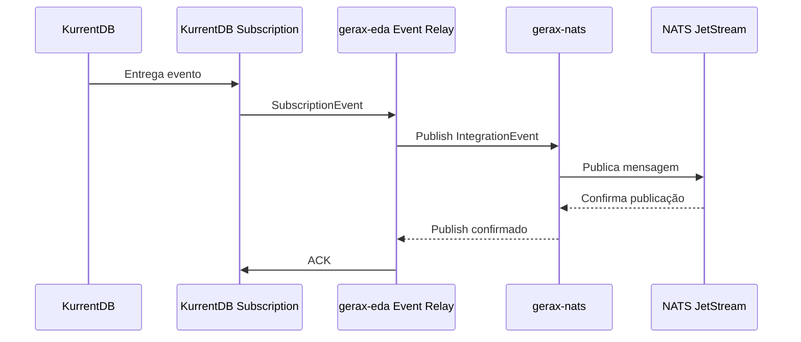

# Skill: Implementação da gerax-kurrentdb

## 1. Objetivo

Implementar a crate `gerax-kurrentdb`, responsável pela integração do framework Gerax com o KurrentDB.

A implementação deve oferecer duas funcionalidades independentes:

1. **Event Store:** persistência e recuperação dos eventos dos Aggregates, implementando o contrato definido em `gerax-es`.
2. **Persistent Subscriptions:** consumo de eventos persistidos no KurrentDB, oferecendo suporte a ACK, NACK, retry, park e controle de processamento.

A arquitetura deve utilizar o KurrentDB como fonte da verdade do Event Sourcing. A distribuição dos eventos para outros serviços será responsabilidade da camada EDA, utilizando adaptadores de transporte, como `gerax-nats`.

## 2. Arquitetura

### 2.1. Responsabilidades das crates

| Crate | Responsabilidade |
|---|---|
| `gerax-es` | Abstração de Event Store e tipos fundamentais do Event Sourcing |
| `gerax-kurrentdb` | Adaptador KurrentDB, persistência e Persistent Subscriptions |
| `gerax-eda` | Processamento, orquestração, Event Relay e distribuição de eventos |
| `gerax-nats` | Publicação e integração com NATS e JetStream |

### 2.2. Fluxo arquitetural



O fluxo de persistência e o fluxo de distribuição são independentes.

O Command Handler persiste os eventos exclusivamente no Event Store. Não deve publicar diretamente no broker.

O Event Relay consome os eventos persistidos no KurrentDB e os encaminha ao NATS JetStream.

### 2.3. Princípios arquiteturais

- KurrentDB é a fonte da verdade dos eventos de domínio.
- Não implementar dual-write entre KurrentDB e NATS.
- O Event Store deve preservar o controle de concorrência otimista.
- Persistent Subscription deve permitir múltiplas instâncias consumidoras.
- O Event Relay deve utilizar entrega at-least-once.
- Consumidores devem implementar idempotência.
- O identificador original do evento deve ser preservado durante toda a distribuição.
- A implementação específica do KurrentDB não deve contaminar as abstrações de `gerax-eda`.

## 3. Estrutura da crate

A implementação deve manter o Event Store e as Subscriptions na mesma crate, mas em módulos independentes.

```text
gerax-kurrentdb/
├── Cargo.toml
├── README.md
├── src/
│   ├── lib.rs
│   ├── client.rs
│   ├── config.rs
│   ├── error.rs
│   ├── event_store/
│   │   ├── mod.rs
│   │   ├── store.rs
│   │   ├── mapper.rs
│   │   └── stream.rs
│   └── subscription/
│       ├── mod.rs
│       ├── config.rs
│       ├── consumer.rs
│       ├── event.rs
│       ├── ack.rs
│       ├── manager.rs
│       └── error.rs
└── tests/
    ├── event_store.rs
    └── subscription.rs
```

### 3.1. Separação dos módulos

**`event_store/`**

Implementa o contrato `EventStore` definido em `gerax-es`.

**`subscription/`**

Implementa a integração técnica com Persistent Subscriptions do KurrentDB.

**`client.rs`**

Gerencia a criação e configuração do cliente KurrentDB.

**`config.rs`**

Centraliza as configurações de conexão.

**`error.rs`**

Centraliza os erros de conexão e integração.

Não criar uma crate separada para subscriptions nesta etapa.

## 4. Tecnologias

Utilizar:

- Rust Edition 2024.
- Tokio para execução assíncrona.
- `kurrentdb` como cliente Rust do KurrentDB.
- `async-trait` para contratos assíncronos, quando necessário.
- `serde` e `serde_json` para serialização.
- `chrono` para datas e horários.
- `uuid` para identificadores.
- `tracing` para observabilidade.

Antes de implementar, verificar a versão efetivamente utilizada do crate `kurrentdb` e consultar sua API correspondente. Não presumir assinaturas de métodos de versões diferentes.

## 5. Cliente KurrentDB

Implementar um cliente compartilhado pela persistência e pelas subscriptions.

```rust
pub struct KurrentDbClient {
    client: kurrentdb::Client,
}
```

Responsabilidades:

- Criar conexão a partir de uma connection string.
- Disponibilizar acesso controlado ao cliente.
- Centralizar configurações.
- Permitir reutilização pela implementação de Event Store e Subscription.
- Propagar erros de conexão de maneira tipada.

A API pública deve permitir construção por configuração e reutilização de um cliente existente.

## 6. Event Store

### 6.1. Contrato existente

A implementação deve preservar integralmente o contrato já definido em `gerax-es`:

```rust
#[async_trait]
pub trait EventStore: Send + Sync {
    async fn load(
        &self,
        aggregate_type: &str,
        aggregate_id: &str,
    ) -> Result<Vec<StoredEvent>, EventStoreError>;

    async fn append(
        &self,
        aggregate_type: &str,
        aggregate_id: &str,
        expected_version: Version,
        events: Vec<StoredEvent>,
    ) -> Result<(), EventStoreError>;
}
```

Não alterar esse contrato para acomodar particularidades do KurrentDB.

### 6.2. Implementação

Criar:

```rust
pub struct KurrentDbEventStore {
    client: KurrentDbClient,
}
```

Implementar `EventStore` para `KurrentDbEventStore`.

### 6.3. Nome dos streams

Utilizar o padrão:

```text
{aggregate_type}-{aggregate_id}
```

Exemplo:

```text
Aluno-123
Paciente-456
Pedido-789
```

Centralizar a construção do nome do stream no módulo `stream.rs`.

### 6.4. Carregamento de eventos

O método `load` deve:

1. Construir o nome do stream.
2. Realizar leitura em ordem crescente de revisão.
3. Recuperar todos os eventos do Aggregate.
4. Converter os eventos persistidos em `StoredEvent`.
5. Retornar uma lista vazia quando o stream não existir.
6. Propagar erros de leitura e desserialização.

A leitura deve preservar a ordem original dos eventos.

### 6.5. Persistência de eventos

O método `append` deve:

1. Validar a sequência dos eventos recebidos.
2. Retornar sucesso quando a lista estiver vazia.
3. Converter os eventos para `EventData`.
4. Serializar payload e metadados.
5. Utilizar controle de concorrência otimista.
6. Executar o append no stream.
7. Mapear conflitos de concorrência para os erros definidos em `gerax-es`.

### 6.6. Versionamento

O Gerax utiliza versão inicial zero, enquanto o KurrentDB utiliza revisão inicial zero para o primeiro evento.

A conversão deve respeitar:

| Gerax | KurrentDB |
|---|---|
| `Version::initial()` = 0 | `StreamState::NoStream` |
| `Version::new(1)` | Revisão 0 |
| `Version::new(2)` | Revisão 1 |
| `Version::new(n)` | Revisão n - 1 |

Na recuperação, converter a revisão do KurrentDB para a versão Gerax somando um.

### 6.7. Concorrência otimista

Utilizar `expected_version` para impedir gravações concorrentes indevidas.

Mapear `WrongExpectedVersion` para `EventStoreError::Concurrency`.

Não implementar retry automático de conflitos dentro do adaptador.

A aplicação deve:

1. Recarregar o Aggregate.
2. Reexecutar o Command.
3. Gerar novos eventos, se aplicável.
4. Tentar persistir novamente.

### 6.8. Metadados

Preservar, no mínimo:

- `aggregate_type`
- `aggregate_id`
- `occurred_at`
- `event_id`
- Metadados adicionais do evento.

Utilizar metadados customizados do KurrentDB, mantendo compatibilidade com os tipos definidos em `gerax-es`.

## 7. Persistent Subscriptions

### 7.1. Objetivo

Implementar o consumo de eventos persistidos no KurrentDB utilizando Persistent Subscriptions.

O módulo deve oferecer uma abstração técnica para que a `gerax-eda` consiga consumir eventos sem depender diretamente dos tipos internos do cliente KurrentDB.

A subscription deve permitir:

- Consumo contínuo de eventos.
- Retomada após desconexões.
- Múltiplos consumidores no mesmo grupo.
- ACK e NACK.
- Retry de eventos.
- Park de eventos problemáticos.
- Configuração de grupos de consumo.
- Controle de concorrência e quantidade de eventos em processamento.

### 7.2. Configuração

Criar uma configuração própria:

```rust
pub struct SubscriptionConfig {
    pub stream: String,
    pub group: String,
    pub buffer_size: usize,
    pub max_retry_count: u32,
}
```

A estrutura pode ser ampliada conforme os recursos efetivamente suportados pela versão do cliente KurrentDB.

A configuração deve contemplar, quando disponível:

- Nome do stream ou `$all`.
- Nome do grupo.
- Número máximo de eventos em processamento.
- Buffer de eventos.
- Estratégia de retry.
- Intervalos de retry.
- Política de mensagens não processáveis.
- Filtros de eventos.

Não confundir configuração do grupo com configuração de cada consumidor.

### 7.3. Gerenciamento de grupos

Criar um componente responsável pelo gerenciamento das Persistent Subscriptions.

```rust
pub struct SubscriptionManager {
    client: KurrentDbClient,
}
```

Responsabilidades:

- Criar grupos de subscriptions.
- Consultar grupos existentes.
- Atualizar configurações.
- Excluir grupos.
- Tratar erros de grupos inexistentes ou duplicados.

O gerenciamento de grupos deve ser uma operação administrativa explícita.

Não criar ou modificar grupos indiscriminadamente durante a inicialização de cada instância consumidora.

Múltiplas instâncias da mesma aplicação devem compartilhar o mesmo grupo quando desejarem processamento concorrente de uma mesma assinatura.

Grupos diferentes representam consumidores independentes, com seus próprios checkpoints.

### 7.4. Consumer

Criar a abstração de consumidor:

```rust
pub struct KurrentDbSubscription {
    // cliente e configuração da subscription
}
```

O consumidor deve:

1. Conectar-se ao grupo configurado.
2. Receber eventos.
3. Converter os eventos para um tipo independente do KurrentDB.
4. Disponibilizar os eventos para a camada superior.
5. Permitir ACK ou NACK.
6. Tratar reconexões.
7. Encerrar o consumo de forma controlada.

A API deve permitir que a `gerax-eda` controle o processamento dos eventos.

Não acoplar o consumidor diretamente ao `NatsPublisher`.

### 7.5. Evento recebido

Criar um tipo próprio para representar o evento recebido pela subscription.

Exemplo conceitual:

```rust
pub struct SubscriptionEvent {
    pub id: EventId,
    pub event_type: String,
    pub stream_id: String,
    pub stream_revision: u64,
    pub payload: Vec<u8>,
    pub metadata: Vec<u8>,
}
```

Preservar os dados originais necessários para processamento e confirmação do evento.

O tipo deve permitir que a camada `gerax-eda` construa seu próprio envelope de integração.

Não duplicar tipos existentes em `gerax-es`. Reutilizar `EventId`, `StoredEvent` e outros tipos compartilhados quando suas semânticas forem compatíveis.

### 7.6. ACK e NACK

Criar uma abstração de confirmação:

```rust
pub enum SubscriptionAck {
    Ack,
    Retry,
    Park,
    Skip,
}
```

A implementação deve mapear essas ações para as operações efetivamente disponíveis no cliente KurrentDB.

Semântica:

| Ação | Comportamento |
|---|---|
| ACK | Evento processado com sucesso |
| Retry | Solicitar nova tentativa de processamento |
| Park | Encaminhar evento para tratamento posterior |
| Skip | Ignorar o evento de acordo com a política definida |

O ACK deve ocorrer somente após a confirmação do processamento pela camada superior.

### 7.7. Tratamento de falhas

A implementação deve distinguir:

**Falhas transitórias**

- Falha temporária de conexão.
- Timeout.
- Indisponibilidade temporária do broker.
- Erros temporários de processamento.

Devem permitir retry.

**Falhas permanentes**

- Payload inválido.
- Evento incompatível.
- Erro de contrato.
- Evento que não pode ser processado.

Devem permitir Park ou outra política explícita.

A política de retry deve ser configurável.

Evitar loops infinitos de retry sem controle.

### 7.8. Ordenação

Preservar a revisão original do stream.

A arquitetura deve permitir que a camada superior identifique a sequência dos eventos de cada Aggregate.

Não assumir ordenação global quando existirem múltiplos consumidores concorrentes.

Quando a ordem por Aggregate for requisito de negócio, a implementação do processamento deve respeitar a revisão do stream e evitar processamento simultâneo incompatível para o mesmo Aggregate.

## 8. Integração com gerax-eda

A `gerax-kurrentdb` não deve implementar o Event Relay.

Sua responsabilidade termina na entrega do evento e na confirmação técnica da subscription.

A `gerax-eda` deve coordenar o processamento.

Estrutura conceitual:

```text
gerax-eda/
├── event_relay/
│   ├── mod.rs
│   ├── relay.rs
│   ├── dispatcher.rs
│   ├── handler.rs
│   └── envelope.rs
```

O Event Relay deve consumir a abstração disponibilizada por `gerax-kurrentdb` e publicar por meio de uma abstração de publisher.

Não introduzir dependência de KurrentDB dentro dos contratos centrais de `gerax-eda`.

### 8.1. Fluxo do Event Relay



Regra fundamental:

**O ACK no KurrentDB só deve ocorrer depois da confirmação de publicação no NATS JetStream.**

### 8.2. Falha durante a publicação

Se a publicação no NATS falhar:

1. Não confirmar o evento no KurrentDB.
2. Aplicar a política de retry.
3. Registrar a falha.
4. Permitir que o KurrentDB reentregue o evento.

Se a publicação for concluída, mas o processo falhar antes do ACK:

1. O KurrentDB poderá entregar o evento novamente.
2. O relay poderá republicá-lo.
3. O consumidor poderá receber uma duplicata.

Esse comportamento é esperado em uma arquitetura at-least-once.

Não afirmar que existe entrega exactly-once entre KurrentDB e NATS.

## 9. Envelope de integração

A `gerax-eda` deve definir ou reutilizar um envelope de integração apropriado.

Modelo conceitual:

```rust
pub struct IntegrationEvent {
    pub id: EventId,
    pub event_type: String,
    pub aggregate_id: String,
    pub aggregate_type: String,
    pub stream_revision: u64,
    pub occurred_at: DateTime<Utc>,
    pub correlation_id: Option<String>,
    pub causation_id: Option<String>,
    pub payload: serde_json::Value,
    pub metadata: EventMetadata,
}
```

O envelope deve preservar:

- Identificador original do evento.
- Tipo do evento.
- Aggregate de origem.
- Revisão do stream.
- Data de ocorrência.
- Correlation ID.
- Causation ID.
- Payload.
- Metadados.

Antes de criar esse tipo, verificar se a `gerax-eda` ou `gerax-es` já possui uma estrutura equivalente. Reutilizar a estrutura existente quando possível.

## 10. Integração com gerax-nats

A `gerax-nats` será responsável pela integração com NATS.

O Event Relay deve utilizar uma abstração de publicação, sem depender de detalhes do protocolo NATS.

Exemplo de subject:

```text
gerax.educacao.aluno.matriculado.v1
gerax.clinica.paciente.cadastrado.v1
gerax.vendas.pedido.criado.v1
```

Preservar o `event_id` original na mensagem.

Utilizar o mecanismo de confirmação de publicação do JetStream antes de enviar ACK ao KurrentDB.

A estratégia de deduplicação do JetStream pode ser utilizada como proteção adicional, mas não substitui a idempotência dos consumidores.

## 11. Idempotência e duplicidade

A arquitetura deve assumir entrega at-least-once.

Cada consumidor deve implementar deduplicação com base no identificador único do evento.

Quando necessário, utilizar uma tabela ou armazenamento de eventos processados.

Exemplo conceitual:

```text
processed_events
----------------
consumer_name
event_id
processed_at
```

A gravação do identificador de processamento e a alteração de estado de negócio devem ocorrer na mesma transação local, quando o armazenamento permitir.

Não utilizar apenas o ACK do broker como mecanismo de idempotência.

## 12. Observabilidade

Instrumentar a implementação com `tracing`.

Registrar:

- Conexões e desconexões.
- Operações de leitura e append.
- Conflitos de concorrência.
- Criação e remoção de grupos.
- Eventos recebidos.
- ACK e NACK.
- Falhas de publicação.
- Retry e Park.
- Tempo de processamento.
- Identificadores de evento e Aggregate.

Evitar registrar payloads sensíveis.

Utilizar campos estruturados para `event_id`, `aggregate_id`, `stream_revision`, `subscription_group` e `correlation_id`.

## 13. Tratamento de erros

Definir erros tipados e preservar a origem das falhas.

Separar:

- Erros de conexão.
- Erros de configuração.
- Erros de leitura.
- Erros de append.
- Erros de concorrência.
- Erros de serialização.
- Erros de subscription.
- Erros de ACK/NACK.
- Erros de gerenciamento de grupos.

Não converter todos os erros para `String`.

Preservar a compatibilidade com `EventStoreError` e `ConcurrencyError` existentes em `gerax-es`.

## 14. Testes

### 14.1. Testes unitários do Event Store

- Conversão de versões.
- Construção de stream names.
- Validação da sequência de eventos.
- Serialização e desserialização.
- Conversão de metadados.
- Mapeamento de erros.
- Mapeamento de conflitos de concorrência.

### 14.2. Testes de integração do Event Store

- Criar stream.
- Persistir eventos.
- Recuperar eventos.
- Persistir múltiplos eventos.
- Validar concorrência otimista.
- Recuperar stream inexistente.

### 14.3. Testes de Persistent Subscription

- Criar grupo.
- Conectar consumidor.
- Receber evento.
- Confirmar evento com ACK.
- Solicitar retry.
- Encaminhar evento para Park.
- Retomar consumo após desconexão.
- Compartilhar grupo entre múltiplas instâncias.
- Consumir eventos de grupos independentes.

### 14.4. Testes do Event Relay

Implementar testes de integração envolvendo:

```text
KurrentDB -> Persistent Subscription -> Event Relay -> NATS JetStream
```

Validar:

- Publicação confirmada antes do ACK.
- Falha no NATS sem ACK.
- Reentrega após falha do relay.
- Duplicidade de publicação.
- Preservação do `event_id`.
- Preservação da revisão do stream.
- Idempotência do consumidor.

## 15. Configuração

Permitir configuração por código e por arquivo de configuração do Gerax.

Exemplo conceitual:

```toml
[kurrentdb]
connection_string = "kurrentdb://localhost:2113"

[kurrentdb.subscription]
buffer_size = 100
max_retry_count = 5
```

A configuração deve respeitar o padrão já utilizado por `gerax-config`.

Não armazenar credenciais diretamente em arquivos versionados.

## 16. API pública esperada

A API pública deve ser simples e separar as duas funcionalidades.

Exemplo conceitual:

```rust
use gerax_kurrentdb::{
    KurrentDbClient,
    KurrentDbEventStore,
    KurrentDbSubscription,
    SubscriptionConfig,
    SubscriptionManager,
};
```

A construção do Event Store não deve exigir a criação de uma subscription.

Da mesma forma, a criação de uma subscription não deve depender da utilização do Event Store como objeto de persistência.

Ambos podem compartilhar o mesmo cliente KurrentDB.

## 17. Fases de implementação

### Fase 1 — Cliente e configuração

- Implementar `KurrentDbClient`.
- Implementar configuração.
- Implementar erros.
- Testar conexão.

### Fase 2 — Event Store

- Implementar `KurrentDbEventStore`.
- Implementar leitura.
- Implementar append.
- Implementar serialização.
- Implementar controle de concorrência.
- Garantir compatibilidade com `gerax-es`.

### Fase 3 — Persistent Subscriptions

- Implementar `SubscriptionConfig`.
- Implementar `SubscriptionManager`.
- Implementar criação e gerenciamento de grupos.
- Implementar `KurrentDbSubscription`.
- Implementar recebimento de eventos.
- Implementar ACK/NACK.
- Implementar retry e Park.
- Implementar reconexão.

### Fase 4 — Integração com gerax-eda

- Implementar ou adaptar o contrato de consumo.
- Implementar Event Relay.
- Implementar dispatcher.
- Implementar envelope de integração.
- Integrar com o publisher abstrato.

### Fase 5 — Integração com gerax-nats

- Implementar publicação no JetStream.
- Aguardar confirmação de publicação.
- Integrar confirmação com ACK do KurrentDB.
- Validar comportamento at-least-once.
- Testar duplicidade e idempotência.

### Fase 6 — Qualidade e documentação

- Testes unitários.
- Testes de integração.
- Documentação de configuração.
- Exemplos de utilização.
- Documentação arquitetural.
- Exemplos com múltiplas instâncias consumidoras.

## 18. Critérios de aceitação

A implementação será considerada concluída quando:

1. `KurrentDbEventStore` implementar integralmente o contrato `EventStore` de `gerax-es`.
2. A persistência respeitar o controle de concorrência otimista.
3. A recuperação preservar a ordem dos eventos.
4. A conversão de versões estiver correta.
5. Persistent Subscriptions funcionarem independentemente do Event Store.
6. Múltiplos consumidores puderem compartilhar um grupo.
7. ACK/NACK estiverem implementados.
8. Eventos puderem ser recuperados após desconexões.
9. O Event Relay estiver implementado em `gerax-eda`, sem acoplamento com o cliente KurrentDB.
10. A publicação no NATS ocorrer antes do ACK no KurrentDB.
11. O `event_id` original for preservado.
12. O sistema tratar duplicidade e entrega at-least-once.
13. Os testes unitários e de integração forem aprovados.

## 19. Diretrizes para o agente de implementação

Antes de alterar o código:

1. Inspecionar a estrutura atual do workspace Gerax.
2. Ler os contratos existentes em `gerax-es`.
3. Inspecionar a implementação atual de `gerax-kurrentdb`.
4. Inspecionar as abstrações existentes em `gerax-eda`.
5. Inspecionar a API existente de `gerax-nats`.
6. Verificar as versões das dependências e suas APIs.
7. Identificar tipos e abstrações que podem ser reutilizados.

Durante a implementação:

- Não duplicar abstrações existentes.
- Não alterar contratos públicos sem justificativa.
- Não introduzir dependências circulares.
- Não acoplar `gerax-kurrentdb` ao NATS.
- Não implementar Event Relay dentro de `gerax-kurrentdb`.
- Não implementar dual-write.
- Não assumir exactly-once.
- Não inventar APIs do cliente KurrentDB.
- Manter compatibilidade com Rust Edition 2024.
- Executar `cargo fmt`, `cargo check` e `cargo test`.

**Decisão arquitetural final:** `gerax-kurrentdb` contém dois módulos independentes — `event_store` e `subscription`. A `gerax-eda` orquestra o Event Relay, e a `gerax-nats` implementa o transporte. O KurrentDB permanece como fonte da verdade do Event Sourcing.